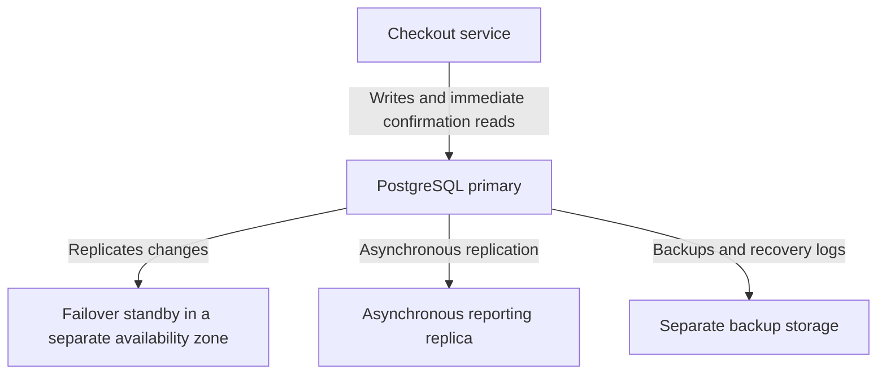

# Portfolio 5 - Distributed and Cloud Databases

## Current cloud deployment

MarketBridge uses PostgreSQL on Supabase. I ran a read-only query to verify
the PostgreSQL version, check whether the connected server was in recovery,
and count records from the earlier portfolio activities.

| Check | Observed result |
|---|---:|
| Database name | `postgres` |
| PostgreSQL version | `17.11` |
| `pg_is_in_recovery()` | `false` |
| Customers | 100 |
| Sales orders | 20,000 |
| JSONB catalogue documents | 3 |

The server that handled the query was outside recovery mode. The query
verified access to the cloud database and its data. Replica configuration,
backup coverage and automatic failover were outside the scope of this test.

## Proposed architecture

The primary would handle order creation, stock deductions and immediate
order-confirmation reads. Keeping confirmation reads on the primary lets
customers see their orders immediately after checkout. Reports can use an
asynchronous replica because they can tolerate a delay. Monitor replication
lag and flag reports when the data exceeds the agreed freshness limit.

A standby in a separate availability zone would give MarketBridge a recovery
path if the primary fails. Synchronous replication can reduce potential data
loss because checkout waits for standby acknowledgement. That wait can also
increase checkout latency. The replication mode should reflect MarketBridge's
tolerance for data loss and the checkout latency measured during testing.

## Failover and backup recovery

If the primary fails, isolate it from writes before promoting the standby.
Redirect checkout to the promoted server. Before reopening checkout, run a
test order and verify that the order, its line item and the inventory
deduction are all visible. Check reporting replica lag before resuming reports.

Test backup restoration separately. Replication can copy an accidental
deletion to another server. A retained backup and recovery logs can support
restoration to a point before the deletion.

## Sharding decision

Start with one writer because checkout updates orders and inventory in the
same transaction. Splitting those records across shards would add coordination
to checkout. Use the reporting replica to reduce read pressure first.
Reconsider sharding if measured write throughput or storage growth exceeds
what one primary can handle.

## Evidence

- [Cloud verification query](cloud_verification.sql)
- [Supabase verification results](cloud_verification.csv)
- [Supabase result screenshot](cloud_verification.png)
